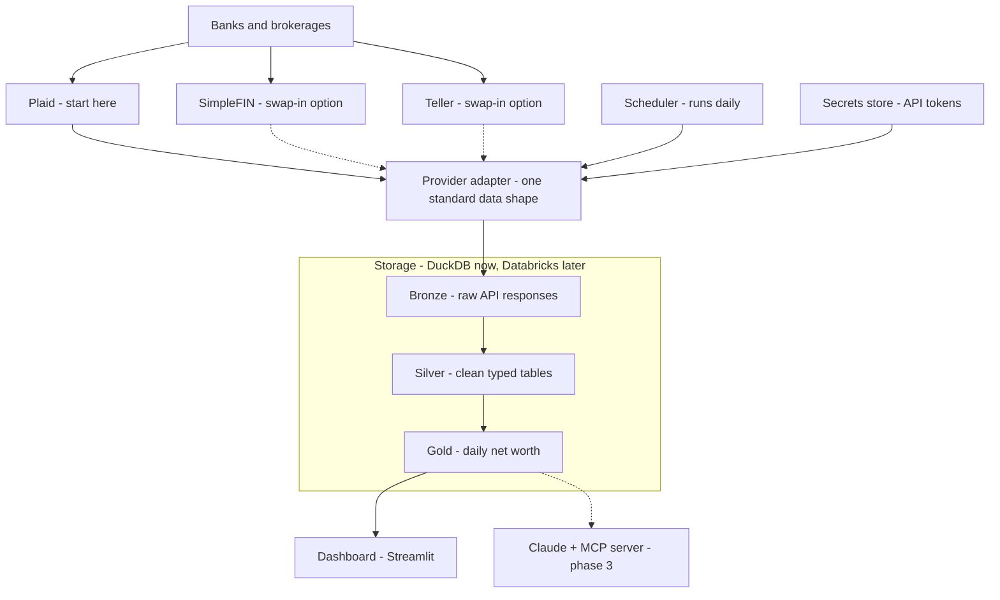

# Architecture

Status: proposed, stack confirmed by the owner on 2026-10-28. Pricing and eligibility facts were checked on that date and can change; verify with each vendor before relying on them.

## Diagram

Solid arrows are built in phase 1. Dashed arrows are swap-in options or later phases.

## Why each piece exists

### Aggregator: Plaid first
Plaid has an unlimited free sandbox and a free Trial plan limited to 10 production connections for newer US and Canada accounts, which is enough for one person's accounts. Its pricing beyond the Trial is not published. SimpleFIN Bridge is a cheaper fallback at about $15 a year, covering up to 25 institutions. Teller advertises a free developer tier of 100 connections, but one unverified report claims it is shutting down, so it is not a dependency. Whichever provider is chosen, institution coverage must be checked against the owner's actual banks before going to production.

### Provider adapter
Every aggregator returns different shapes and sign conventions. The adapter converts them into one internal format (account, balance, transaction), so the store, reports, dashboard and Claude never know which vendor was used. This turns a vendor swap into writing one class instead of touching the whole app. Only code under `providers/` may import a provider SDK.

### Scheduler and secrets store
Plaid returns current balances, not history. The only way to have a history is to snapshot every day, so a scheduled job is a core requirement, not an extra. Access tokens grant read access to real accounts, so they live in a git-ignored, permission-restricted secrets store from day one, and move to a cloud secrets manager when the app moves to Databricks.

### Medallion layers: bronze, silver, gold
- Bronze keeps raw responses untouched, so a bug in later logic can be fixed by replaying the raw data instead of losing history.
- Silver holds typed, deduplicated accounts, balances and transactions.
- Gold holds the business answers, mainly daily net worth, computed in SQL.

The one-way flow makes every number traceable to its source and mirrors the Databricks lakehouse pattern, so the design carries over directly.

### DuckDB
A single-file analytical database with strong SQL and no server. SQLite is weaker for time-series analytics, and Postgres needs a running server for no benefit at this size. DuckDB SQL ports to Databricks SQL and Delta with little change.

### Plain SQL plus Python, scheduled
With a handful of tables, dbt and Dagster add two tools before there is data to manage. SQL files plus a small Python runner on cron or GitHub Actions are the fewest moving parts and port cleanly to Lakeflow later. Revisit when the number of models makes dependency management painful.

### Streamlit
The fastest way to see real data on screen. It is a phase 1 tool and is replaced by Databricks AI/BI in phase 2, so the dashboard holds no business logic. Logic lives in gold.

### Claude and MCP server (phase 3)
Claude is added last, after the data is trustworthy. It reads only the gold tables through a small MCP server with read-only tools, and receives only transaction date, amount, description and category, never account numbers or tokens.

## Data rules that follow from the design

- Money is `Decimal`, never `float`.
- Assets are positive and liabilities negative; transaction inflows are positive.
- History begins at the first sync. Backfilling earlier history from transaction records is possible but is a separate, approved change.
- Syncs are idempotent, so reruns never duplicate data.

## Phases

| Phase | Scope | Cost |
| --- | --- | --- |
| 1 | Plaid sandbox, then free Trial, DuckDB, SQL transforms, Streamlit | Free |
| 2 | Move storage and pipelines to Databricks with Unity Catalog governance | Usage-based |
| 3 | Claude agent and MCP server over gold | Per-token API cost |

## Open risks

- Plaid Trial eligibility and institution coverage are unconfirmed for this owner.
- Databricks Free Edition has one small SQL warehouse and restricted outbound network access, so live ingestion cannot run there; ingestion stays outside it until a paid workspace is used.
- No historical balances before the first sync.
